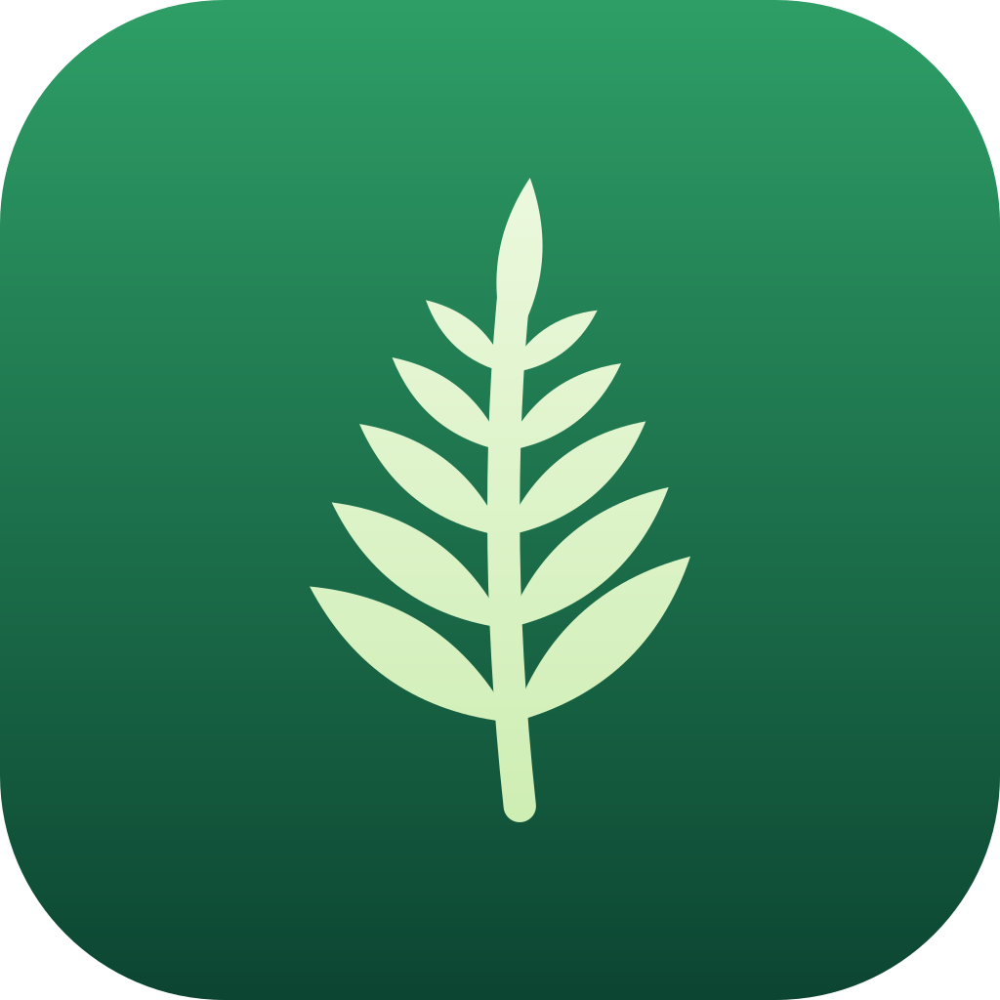
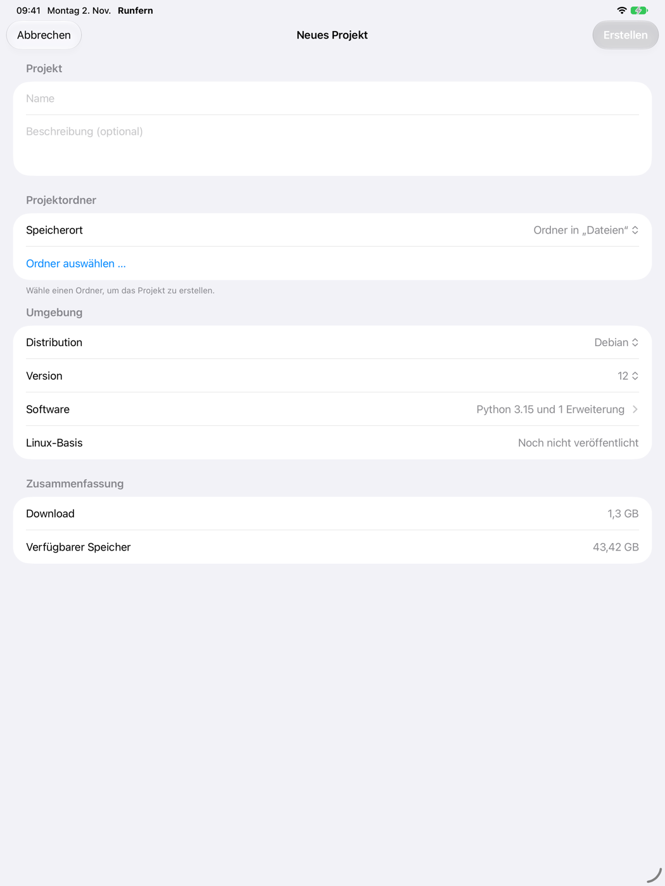
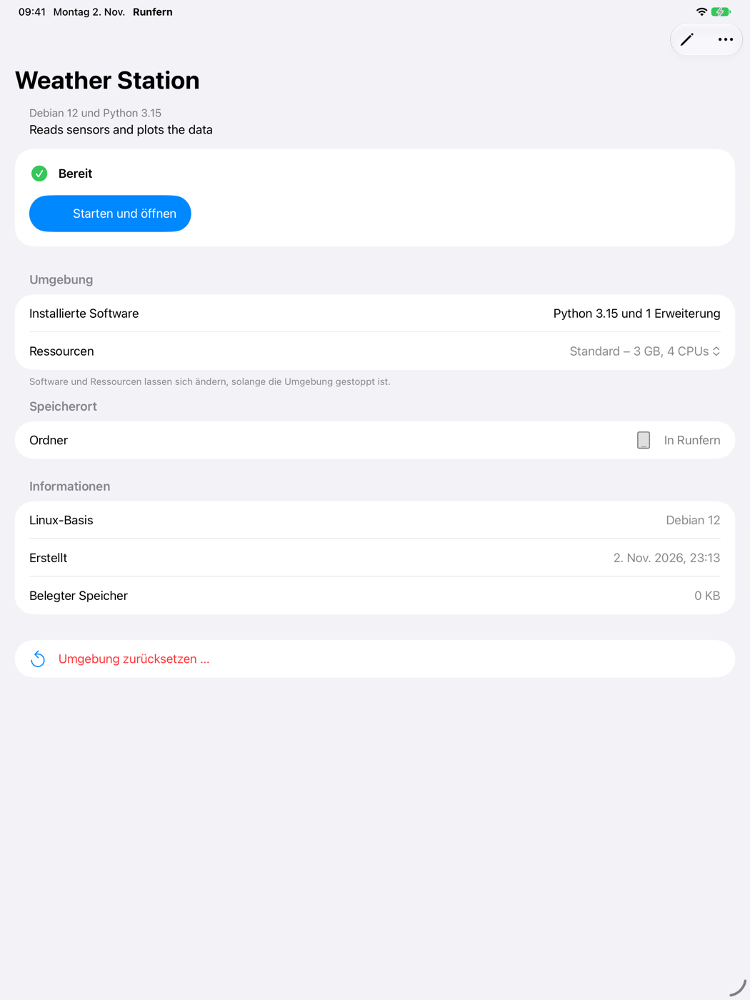
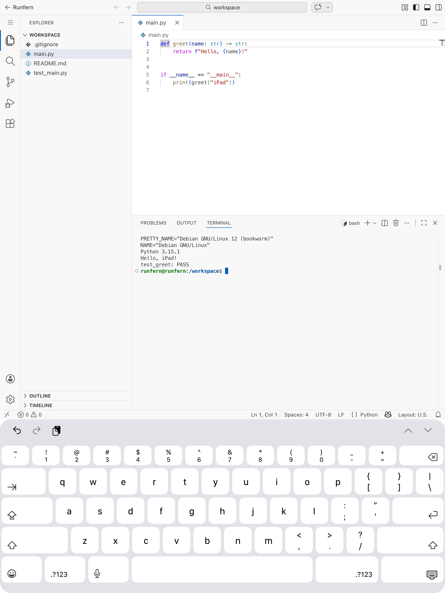

<p align="center">
  
</p>

<h1 align="center">Runfern</h1>

<p align="center">
  Linux and a VS Code-based editor on your iPad.<br>
  <a href="https://github.com/morzan1001/Runfern/releases/latest"></a>
  
  <a href="LICENSE"></a>
</p>

<p align="center">
  
  &nbsp;
  
  &nbsp;
  
</p>

Runfern runs an ARM64 Linux VM locally through QEMU and opens OpenVSCode Server in the app.

- **Linux on the iPad:** Debian, Ubuntu or Fedora from a signed, checksum-pinned catalog
- **Per-project setup:** languages, tools and editor extensions, or a reusable preset
- **Local:** projects live in local folders, and installed environments run on the device

## Getting started

Requires iPadOS 27 or later. [v0.0.1](https://github.com/morzan1001/Runfern/releases/tag/v0.0.1)
is a preview: the JIT build is an unsigned IPA that you re-sign for your device. Built-in JIT
needs Developer Mode, pairing and Network Extension signing; ordinary sideload signing may need
an external JIT method. The App Store build (interpreter, no JIT) follows once the native
dependency license review is complete.

Linux bases and tools are downloaded on first use from
[catalog v1](https://github.com/morzan1001/Runfern/releases/tag/catalog-v1), including their
sources and licenses.

## Building

Build [QEMU](Tools/QEMU/README.md), then:

```sh
Tools/JIT/build-jit-vendor.sh
RUNFERN_INTERNAL_BUILD=1 Tools/Build/build.sh jit
RUNFERN_INTERNAL_BUILD=1 Tools/Build/build.sh appstore-archive
```

More: [builds and releases](Tools/Build/README.md) · [catalog](Tools/Catalog/README.md) ·
[license evidence](Tools/Licenses/README.md)

## Licenses

Runfern's own code is [MIT](LICENSE). Embedded dependencies keep their licenses, including
QEMU (GPLv2), StikJIT (MPL-2.0, JIT builds only), idevice (MIT plus its dependencies) and
devicon language icons (MIT; names and logos remain their owners' trademarks). The app lists
all third-party notices under **Settings > Components and Licenses**.
